<!--
  adnan.log: the profile README of @AdnanSN.
  Printed sheets in assets/ are built by .github/readme/build_static.py (see .github/readme/HOW-IT-WORKS.md).
  The stats sheet and the snake are reprinted every night by .github/workflows/profile-graphs.yml
  and published to the `output` branch.
-->

  

  
  
  
  
  

### 🏆 Fresh off the printer

In October 2026, [@Arnie1x](https://github.com/Arnie1x) and I won the **SereneDB challenge** ("Making Sense of Logs") at the **schubKI National AI Hackathon 2026**. Our project, **[Exhibit](https://github.com/Arnie1x/exhibit)**, is an MCP server that answers questions about logs for engineers, team leads and managers. We built it on one rule: SQL computes, the LLM explains. Every number in an answer comes with the query that produced it, so anyone can re-run it. My lane was the data and the SQL: views, role-scoped access, and checking every figure against ground truth.

The numbers behind the charts

| What we measured | Value |
| --- | --- |
| BGL log lines parsed | 4,747,963 |
| OpenStack log lines parsed | 207,812 |
| OTel rows indexed (a 10-second slice of a 1-billion-row file) | 5,275,597, indexed in 60 s |
| Phrase + facet search over that slice | 13 ms |
| Incidents in 152,734 "data TLB error interrupt" lines, at a 1 / 5 / 60-minute gap | 132 / 117 / 57 |
| Share of those lines from a single node | 99.64% |
| Eval questions matching golden SQL | 15 of 15 |
| Full rebuild from raw logs | about 20 s |

### 🛠️ Things I've shipped

<table>
<tr>
<td width="50%" valign="top">

**🔎 [Exhibit](https://github.com/Arnie1x/exhibit)** 
Role-aware log intelligence over SereneDB, built in 48 hours with [@Arnie1x](https://github.com/Arnie1x). Engineers get incidents instead of raw lines, and a lint step rejects any answer that claims more than the logs can show. 
`SQL` `SereneDB` `MCP` `Docker`

</td>
<td width="50%" valign="top">

**🎬 Training-content pipeline** at SARAEdx Foundry 
Turns expert screen recordings into structured training documents: faster-whisper transcripts, LLM-written scripts validated as JSON with Pydantic, a self-check against the source, and a human approval gate. Shipped on AWS (EC2, ECS) with Docker and CI/CD. 
`Python` `Pydantic` `OpenAI API` `AWS` `Docker` (client work, private)

</td>
</tr>
<tr>
<td width="50%" valign="top">

**🧾 [Quotation SaaS](https://quotation-pearl.vercel.app)** 
For Indian supplier SMBs: an LLM reads a customer's messy RFQ and turns it into structured line items and a draft quote. 
`Next.js` `Supabase` `PostgreSQL` `Google OAuth` `LLMs`

</td>
<td width="50%" valign="top">

**☕ [Morrick's Keep Coffee](https://morrickskeepcoffee.com)** 
Online store for a coffee roaster, from scope and pricing through payments to the custom domain. 
`Next.js` `TypeScript` `Supabase` `Cashfree` `Vercel`

</td>
</tr>
<tr>
<td width="50%" valign="top">

**🏛️ Archivio** 
Project management for a growing architecture firm, built around handing out and tracking tasks across the office. 
`Supabase` `Vercel` (client work, private)

</td>
<td width="50%" valign="top">

**📄 Research and hackathons** 
Papers on *Hybrid Edge-Based Traffic Signal Control Using Reinforcement Learning* and a *Conversational AI-Driven Image Recognition Chatbot with Webcam Integration* (NCAIBIA 2025). My final-year project was an AI + IoT traffic-management system, and an AI study planner I built placed top 5 of 60 teams at SRM Hackforge '25. 
`Computer vision` `Reinforcement learning` `IoT`

</td>
</tr>
</table>

From the archive

- [Object detection with YOLOv8](https://github.com/AdnanSN/Object-detection-using-YOLOv8): YOLOv8 + OpenCV
- [Email spam classifier](https://github.com/AdnanSN/Email-spam-classifier-website): scikit-learn model behind a Flask site
- [Student management system](https://github.com/AdnanSN/Student-management-system): Python
- [Code-N-Surge Error404](https://github.com/AdnanSN/Code-N-Surge-Error404): hackathon website

### 🧭 How I got here

### 🧰 What I build with

<table>
<tr><td>Languages</td><td></td></tr>
<tr><td>AI and data</td><td></td></tr>
<tr><td>Web</td><td></td></tr>
<tr><td>Cloud and tools</td><td></td></tr>
</table>

Also in the toolbox: LLM APIs, MCP servers, Pydantic, faster-whisper, SereneDB, Oracle Cloud and Claude Code.

### 📈 Reprinted every night

<picture>
  <source media="(prefers-color-scheme: dark)" srcset="https://raw.githubusercontent.com/AdnanSN/AdnanSN/output/snake-dark.svg">
  
</picture>

### 🎒 Off the keyboard

- 🌍 Swapped Marina Beach for the Weser: Chennai to Bremen is about 7,600 km.
- 🗣️ I speak English, Hindi, Tamil, Urdu and Gujarati, read Arabic, and I'm learning German.
- 🏸 I play in the badminton club at Constructor, I'm learning tennis, and I've played padel and pickleball.
- 🎶 I love going to music festivals.

### 📬 Say hi

Hiring a Werkstudent in Bremen or remotely in Germany? I can work up to 20 hours a week during the semester and full-time in the breaks. [LinkedIn](https://linkedin.com/in/adnansn) or [email](mailto:adnannalawalas@gmail.com) both reach me, and [Instagram](https://instagram.com/_.addstagram._) is for everything else.

